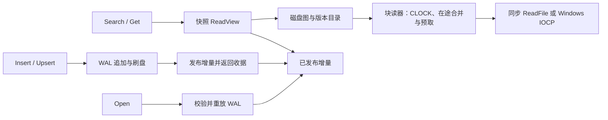
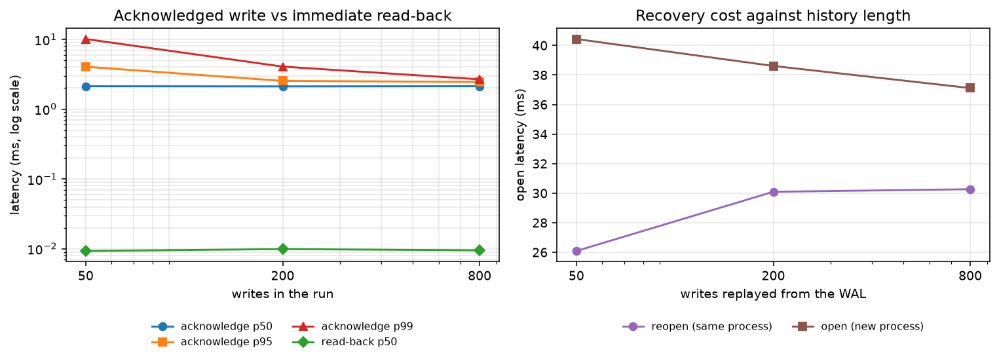

# proj47-RecallFlow

RecallFlow 是为 Agent 长期记忆设计的磁盘向量检索引擎。图索引超过内存时，查询需要频繁读取离散的数据块。读路径使用用户态 CLOCK 缓存、同块在途合并、Windows IOCP 和有界预取。写路径将 `Insert` 和 `Upsert` 顺序追加到 WAL，刷盘后发布并返回收据，重启时重放。核心和基准用 C++20 实现，Python 负责数据准备、实验编排和独立评测。

| 参赛信息 | 内容 |
| --- | --- |
| 赛题 | proj47 · 面向 Agent 记忆的向量检索系统 I/O 优化 |
| 学校 | 中北大学 |
| 队伍 | 页对齐（`T2026101109913134`） |

[开发环境与复现](#开发环境) · [系统架构](#系统架构) · [实验结果](#实验结果) · [项目文档](#项目文档)

## 当前进度

| 能力 | 当前状态 | 证据 |
| --- | --- | --- |
| 静态检索 | `vector_build` 构建自有 FORMAT-1 索引，`Engine` 提供 `Search` 和 `Get`，`vector_bench --target engine` 与 Python 离线答案组成端到端验证 | [静态基线](docs/stage4-b-completion.md) |
| 读路径优化 | CLOCK、在途合并、IOCP 和有界预取已接入静态查询，完成 10 组模式对照和 21 组缓存比例与预取窗口实验 | [读路径交付](docs/stage5-a-completion.md) · [独立复核](docs/stage5-b-completion.md) |
| 动态写入与 WAL 恢复 | `Insert`、`Upsert` 在 WAL 刷盘后发布，`Open` 重放并修复最新日志的合法残尾。已验证进程强制终止后的恢复和后续写入 | [动态闭环与恢复](docs/stage6-b-completion.md) |
| 固定后台读配额 | 已完成块读器组件验证。需求读、预取和后台读共享同一后端，实际合并任务与引擎统计待接入 | [后台读调度](docs/stage7-a-read-scheduling.md) |
| 后续交付 | `Checkpoint` 返回 `unsupported`。增量段落盘、合并、代次切换和真实混合读写评测待完成 | [项目状态与下一步](docs/project-status.md) |

华北区域赛报名截止为 **2026 年 12 月 6 日**，初赛作品提交截止为 **2026 年 12 月 11 日 23:59**。公开页面于 2026 年 11 月 27 日复核。队伍报名与提交回执在队伍账号内核对。[赛程、来源与提交清单](docs/open-questions.md#已核实的赛程与提交信息)

## 开发环境

### 完整测试的前置条件

- 使用原生 Windows x64、Visual Studio 2022 的 C++ 工具链及 Windows SDK，以及 CMake 3.24 或以上版本。
- 安装 Python 3.12 和 [锁定的 Python 依赖](evaluation/requirements.lock.txt)。Python 解释器须在 CMake 配置时存在。
- 准备固定的 Boost 1.78 头文件，`vector_bench` 使用 Boost.JSON。核心库、`vector_build` 和 WAL 测试可以独立构建。DiskANN 0.6.1 是阶段二可选探针的依赖。[依赖版本与来源](docs/third-party.md)
- 使用只含 ASCII 字符的源码、构建、实验及临时路径。按 `.gitattributes` 以 LF 检出源码。若 `trace.jsonl` 显示 `w/crlf` 或评测报校验和错误，优先检出到新的 ASCII 目录，以保留原工作副本。

### 快速开始

在 Visual Studio 2022 Developer PowerShell 中运行。Boost 路径应指向包含 `boost/json/src.hpp` 的目录。

```powershell
$repoUrl = Read-Host '输入仓库克隆地址'
git clone $repoUrl D:\agent-io
Set-Location -LiteralPath D:\agent-io
New-Item -ItemType Directory -Force D:\agent-io-tmp, D:\agent-io-runs | Out-Null
$env:TEMP = 'D:\agent-io-tmp'
$env:TMP = $env:TEMP
git ls-files --eol -- evaluation/examples/stage3-b/trace.jsonl

python -m venv .venv
.\.venv\Scripts\python.exe -m pip install -r evaluation\requirements.lock.txt

$boostInclude = Read-Host '输入 Boost 1.78 头文件目录'
if (-not (Test-Path -LiteralPath (Join-Path $boostInclude 'boost/json/src.hpp'))) {
    throw 'Boost.JSON header not found'
}
cmake -S . -B build/windows -G "Visual Studio 17 2022" -A x64 "-DAGENT_IO_BOOST_INCLUDE=$boostInclude"
cmake --build build/windows --config Release
ctest --test-dir build/windows -C Release --output-on-failure

.\.venv\Scripts\python.exe tools/contracts/run-static-baseline.py `
    --root D:/agent-io-runs --run-id static-001
```

完整配置注册 14 项 CTest。2026 年 11 月 27 日在 `cd8af51` 的干净检出上重新配置和构建，Release 与 Debug 各通过 14/14。若配置日志出现 `vector_bench CLI disabled`，检查 `AGENT_IO_BOOST_INCLUDE`。若 Python 相关测试缺失，确认解释器已创建后重新运行 CMake 配置。静态基线脚本固定使用 `build/windows/Release`。

手动运行 Debug 回归时，沿用上方的 `$boostInclude`，在独立目录 `build/windows-debug` 中配置并清空 DiskANN 源码路径。阶段二引导流程会在 `build/windows` 保留链接 Release DiskANN 的探针。

```powershell
cmake -S . -B build/windows-debug -G "Visual Studio 17 2022" -A x64 `
    "-DAGENT_IO_BOOST_INCLUDE=$boostInclude" '-DAGENT_IO_DISKANN_ROOT:PATH='
cmake --build build/windows-debug --config Debug
ctest --test-dir build/windows-debug -C Debug --output-on-failure
```

静态基线运行 512 条 16 维向量、60 次查询，首次构建和查询分别使用 512 MiB 与 384 MiB 的 Windows Job 提交限额。输出位于 `D:/agent-io-runs/static-001/`，其中 `baseline-summary.json` 应显示 `verdict=pass` 和 `recall_at_k.mean=1.0`。重跑请更换 `--run-id`，或使用空目录。2026 年 11 月 27 日在 `cd8af51` 的干净检出上复现了上述基线。

阶段二引导脚本用于可选的 DiskANN 探针。它先安装锁定的 Python 依赖，再配置、构建并运行 Release 和 Debug 的全量测试。Release 探针位于 `build/windows`，引导脚本的 Debug 回归位于 `build/windows-stage2-debug`。[阶段二环境与验收](docs/stage2-completion.md)

## 系统架构



`vector_bench` 在 C++ 进程中发起请求、计时并写出 JSON/JSONL 工件。Python 在计时路径外准备数据、编排运行并计算精确答案。[总体设计](docs/architecture.md) · [评测协议](docs/evaluation-protocol.md)

## 实验结果

| 实验 | 结果 | 适用范围 |
| --- | --- | --- |
| 静态端到端 | 512 条 16 维向量，60 次查询全部成功，独立 Recall@10 = **1.000** | 候选预算足以接近全图扫描，验证小夹具上的检索与评测链路。[静态基线](docs/stage4-b-completion.md) |
| 同步读取与 CLOCK 对照 | 同一 2 MiB 图、60 次查询、20 ops/s、2 个 worker。8 MiB 预算下，读请求从 **26,310 降到 512**，请求数和完成字节均下降约 **98.05%**。128 KiB 预算下，读请求从 26,310 降到 26,126 | 8 MiB 设置可容纳整图，128 KiB 设置下收益有限。[读路径交付](docs/stage5-a-completion.md) · [汇总数据](docs/evidence/stage5-a/summary.json) |
| 缓存与图的比例 | 4096 节点、16 MiB 图。缓存预算与图等大时命中率 **50.74%**；本档有效数据驻留约为标称预算的 **45.1%** | 驻留比例反映缓存预算记账。预取窗口扫描未观察到稳定的尾延迟改善。[独立复核](docs/stage5-b-completion.md) · [汇总数据](docs/evidence/stage5-b/sweep-summary.json) |
| 动态写入 | 4096 条 16 维向量、50 / 200 / 800 次写入。每次追加一个 **136 字节**的 WAL 帧。端到端确认 p50 为 **2.12–2.13 ms**，独立复跑为 **2.14–2.68 ms** | 设备写放大、`FlushFileBuffers` 的独立耗时和更长 WAL 历史下的性能待测。数据来自 11 月 26 日恢复修复前的实验。[动态闭环](docs/stage6-b-completion.md) · [汇总数据](docs/evidence/stage6-b/sweep-summary.json) |

读取实验统计引擎向后端提交的请求和完成字节。`direct_reads=true` 在 Windows 使用 `FILE_FLAG_NO_BUFFERING`。设备物理 I/O 未测量，现有数据规模和负载仅覆盖本机小夹具。



## 已知限制与路线图

1. 补齐增量段枚举和 `Checkpoint`，再接入后台合并、代次切换与旧文件回收。
2. 将真实写入收据接入 EVAL-1.1，评估 95:5 和 80:20 混合负载下的尾延迟与写入背压。
3. 执行超内存工作集及正式规模的性能和资源评测。持久化验证目前覆盖本机进程故障，断电及设备故障验证待补。

[验收矩阵](docs/acceptance-matrix.md) · [项目状态与退出条件](docs/project-status.md#下一步与退出条件)

## 项目文档

| 路径 | 内容 |
| --- | --- |
| `include/agent_io/` · `src/` | 引擎、索引、存储和基准的公开接口及实现 |
| `tests/` · `tools/` | C++ 测试、基准与首建 CLI、复现脚本和环境探针 |
| `evaluation/` · `configs/` | Python 夹具、离线评测、示例配置和依赖锁定 |
| `docs/` · `docs/evidence/` | 设计契约、阶段交付和入库的实验汇总、日志与图表 |

- [赛题任务书](赛题任务书-面向Agent记忆的向量检索系统IO优化.md) · [参赛技术方案](参赛技术方案.md) · [项目全生命周期](项目全生命周期.md)
- [需求基线](docs/requirements.md) · [两人协作计划](docs/team-plan.md) · [赛程与待确认事项](docs/open-questions.md)
- [C++ 接口约定](docs/interface-contract.md) · [存储格式与恢复](docs/storage-protocol.md) · [Windows 平台约定](docs/windows-platform.md)

## 许可证

Copyright 2026 proj47-RecallFlow contributors.

| 内容 | 许可证 |
| --- | --- |
| 团队自有源代码、脚本及构建和运行配置 | [Apache License 2.0](LICENSE)（Apache-2.0） |
| 团队原创文档（README、`docs/` 中的原创内容、参赛技术方案、项目全生命周期及其导出版本） | [知识共享署名-相同方式共享 4.0 国际许可协议](LICENSE-docs)（CC-BY-SA-4.0） |

文档署名为 proj47-RecallFlow（页对齐团队）及项目贡献者。单独分享或导出文档时，保留署名、许可声明和许可文本或链接，修改时注明变更。外部赛题原文、第三方代码及补丁中的上游内容、引用材料和外部数据集保留各自的授权条件。[第三方依赖与许可证记录](docs/third-party.md)
