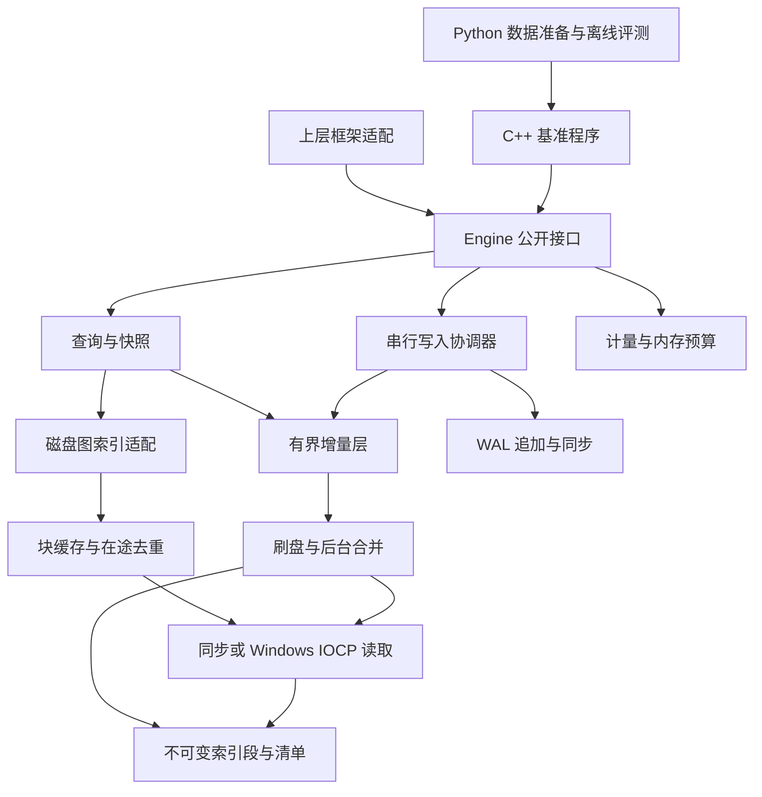

# 总体设计

设计基线 DESIGN-1.1，日期 2026 年 11 月 10 日。对应 REQ-1.0，团队两人，C++20 核心与 Python 离线评测。1.1 将目标平台确定为本机原生 Windows，接口修订为 API-1.1。

阶段二本机工程可行性和阶段三设计验收已通过。阶段四已交付同步存储和静态 C++ 并发基准，待接入真实静态 Engine 并完成独立召回与资源评测。依赖、读路径、容量估算和本机计量见[阶段二验收记录](stage2-completion.md)。平台边界见[Windows 平台约定](windows-platform.md)。

2026 年 11 月 11 日补充第三阶段 A 交付 STORAGE-A-1/API-1.2/EVAL-1.1：只读块租约、批读取、在途去重边界、文件延迟回收、资源预约与模式切换、WAL 编解码及基准输出契约已给出。详见 [A 侧存储与基准契约](stage3-a-contract.md)及[交付记录](stage3-a-completion.md)。2026 年 11 月 16 日补充第三阶段 B 交付 INDEX-B-1：索引适配、稳定增量槽、快照内部类型、RequiredScratch、首次构建受限域、清单与版本目录契约，以及 Python 轨迹与召回校验，见 [B 侧契约](stage3-b-contract.md)及[交付记录](stage3-b-completion.md)。

2026 年 11 月 17 日先修订 INDEX-B-1.1 的序号、前缀与工作区边界，随后按用户指示完成 A/B 联合复核，冻结 DESIGN-1.1。最终契约为 STORAGE-A-1.1 / INDEX-B-1.2，补齐清单 schema 与逻辑读取计量；范围、五处交接与验收证据见[冻结记录](stage3-freeze.md)。本次冻结不表示完整 Engine 已实现。

## 1 设计目标

让数据规模超过内存时的随机读取、并发更新和后台整理能够分别计量、控制和替换，同时保持查询版本一致、成功写入可恢复和资源有界。

主攻用户态块缓存与有界拓扑预取。动态能力先完成正确性和可持续范围的测量；复杂联合控制作为增强项。所有收益在同内存、同写入语义及近似同召回下验证。

## 2 架构与模块



| 模块 | 职责与边界 | 主责 |
| --- | --- | --- |
| Engine | 参数校验、准入、状态机、对外错误和生命周期 | A/B |
| QueryCoordinator | 捕获快照、跨段搜索、版本过滤、精排、结果补充 | B |
| IndexAdapter | 封装成熟图算法和既有索引格式，暴露候选及存储访问 | B |
| BlockReader | 块缓存、在途去重、预取准入，处理失败与等待者 | A |
| ReadBackend | 实际读取、对齐缓冲和完成通知，隐藏 Windows HANDLE/OVERLAPPED 细节 | A |
| WriteCoordinator | 顺序写入发布，序号、冲突、资源预留与错误状态 | B |
| WalWriter | 顺序记录、短写处理、同步和错误上报 | A |
| DeltaStore | 稳定内存槽、已提交前缀、逻辑版本与冻结 | B |
| Maintenance | 刷盘、合并、清单发布、回收与背压 | A/B |
| Benchmark | C++ 发请求与计时，独立保存运行工件 | A |
| Evaluation | Python 精确答案、动态重放、召回、图表与实验管理 | B |

初版不做独立微服务，不引入 Python 原生绑定。核心库与基准程序同进程调用；服务或 Agent 适配仅是调用层，单独测接口开销。

## 3 数据模型与索引适配

逻辑 ID 和提交序号均为无符号 64 位整数；序号 0 表示初始构建版本，后续提交严格递增。版本身份为 `(logical_id, sequence)`，图内部节点编号与逻辑 ID 分离。

单索引固定维度；第一版为有限 float32 输入和平方 L2。计算允许用压缩距离筛选，但返回距离采用原向量、相同度量的 float64 累加。输出按距离升序、逻辑 ID 升序打破并列；同 ID 不重复。

初版增量层采用精确扫描，按单独预算限制条数和字节；它只适合小增量，性能成本必须报告。动态内存图是后续替换项，不能把增量扫描耗时隐藏在基准外。

磁盘主图及冻结磁盘段由 IndexAdapter 访问，底层算法和原生格式沿用经验证的依赖。团队不重新发明整套磁盘图算法，也不在依赖验证前承诺直接兼容其内部结构。

IndexAdapter 的约束如下：

- 输入快照内的不可变段、查询、候选预算与 BlockReader。
- 候选携带内部地址、逻辑 ID 和版本，原向量按需读取精排。
- 过滤只影响结果资格；旧节点仍可参与图导航，不能简单删除入口或导航边。
- 支持增加候选预算重新搜索；初版可以重新调用，后续才考虑可恢复搜索游标。
- 所有磁盘读取必须经过同一存储抽象，否则标注绕行的缓存、内存和 I/O，不能声称已完成读路径替换。
- 依赖若只支持一次性全批读取，先调整适配设计，不能假定已有 IOCP 非阻塞重叠；Windows 构建和读取路径须实证。

## 4 快照与版本可见性

快照内部为：

```text
ReadView {
    instance_id,
    view_generation,
    snapshot_sequence S,
    manifest_generation,
    immutable_disk_segments[],
    pinned_delta_segments[(segment, committed_prefix)],
    live_count
}
```

查询通过短时 publication_mutex 捕获整个 ReadView。写入发布、增量轮换和合并切换使用同一个锁；磁盘读取和距离计算不持有它。

活跃增量使用预分配稳定槽位。每个槽写完后，协调器才在 publication_mutex 下推进已提交前缀和发布序号。查询捕获的前缀以内记录不再改写，后续新增槽位不会进入它的数据视图；不能在捕获后读取会变化的容器长度，也不能让 vector 扩容导致引用失效。

初版每个查询从已捕获的增量前缀建立“受更新 ID 的最高可见序号”影子表，查询工作区为它预留容量。每个不可变磁盘段提供按 ID 定位版本的目录，目录按需读取并受缓存预算约束。比较增量与磁盘段中同 ID 的序号，得到快照最高可见版本；不是仅查一个不断变化的全局 latest_version 映射。

该初版避免复制全量版本表，但增量扫描和跨段版本定位有成本。段数有上限，影子表超工作区预算时拒绝准入，不临时使用无限堆内存。

对外不提供历史快照句柄，也不支持任意序号的 Search。Search/Get 各自捕获当前视图，在返回结果或错误前释放；快照序号用于事后评测，不是历史查询 API。

INDEX-B-1.1 复审明确 ReadView/DeltaPin 只是元数据；读取同时持有 ReadViewLease 的生命周期引用，固定磁盘注册、DeltaStore 与预约。控制块在锁外预先准备，锁内复制不分配。超时后的在途 I/O 仍按 A 的契约持有必要工作区及查询准入槽，直到完成；元数据复制不能代替这些资源引用。

## 5 查询路径

1. 校验维度、非有限数、K 和预算，取得查询槽与工作区。
2. 捕获 ReadView，构建该视图的增量影子表。
3. 对主图与可见磁盘段取候选，对增量前缀扫描，按版本过滤并按逻辑 ID 去重。
4. 候选需要的原始块先查缓存；同块未命中共享一个在途读取，需求读取优先于推测提交。
5. 在已知候选邻居中提交有限预取，同时计算已就绪批次的距离。
6. 原向量精排；有效结果不足 `min(K, live_count)` 时，在总候选预算内扩大搜索。
7. 达预算仍不足时返回 search_incomplete；不返回旧版本补数。候选已足够但搜索碰到预算可成功返回，并记录 candidate_limit_reached。
8. 输出 S、view_generation、带版本的结果和查询计量，释放视图和工作区。

K 大于有效数据数时需要返回全部有效数据；若预算不足以找全，则明确 search_incomplete。近似查询成功只表示协议完整，召回质量仍由独立精确答案检查。

## 6 写入路径

第一版为多线程调用、单写协调器串行提交；组提交窗口可配置，成功语义不改变。

```text
校验与写队列准入
  -> 预留稳定槽、元数据及 WAL 编码缓冲
  -> 检查 insert 冲突 / 确定 upsert 行为
  -> 分配序号并编码完整记录
  -> 追加 WAL 与完成同步
  -> publication_mutex 下发布记录前缀和可见序号
  -> 返回 WriteReceipt
```

发布路径在 WAL 持久化后不可再依赖可能失败的动态分配。冲突按协调器执行顺序判定；同 ID 并发 insert 至多一个成功。

若 WAL 追加前的失败发生在预留槽之后，由单写协调器按尾部逆序 CancelLastSlot，避免未发布空洞阻止后续前缀。开始追加后不得撤销槽或跳过序号继续写入，按不可确定写入处理。

admission_timeout 只限制进入不可撤销写入阶段前的排队和资源等待。一旦开始 WAL 追加，调用等待提交结果；同步的总耗时不承诺被此超时截断，C++ 基准照常计入完整写入延迟。

追加、同步或发布状态不可判定时停止接纳新写入，返回 may_have_applied 和候选序号，进入 recovery_required；已有快照只读允许继续，不能跳过失败日志继续追加成功写入。详见存储协议。

## 7 刷盘、合并与 checkpoint

增量到阈值后在发布锁下冻结并切换到已预留的新活跃段。冻结前缀不变，后台构建可查询磁盘段。发布时将“冻结内存段”替换成等价磁盘段，S 不回退；旧查询保留自己的内存段引用。

初版合并从明确切点 C 读取各段，保留每个逻辑 ID 在 C 的最新向量，构建新的磁盘图与版本目录。高于 C 的更新留在新活跃段，不进入该次合并。发布时必须把当前 C 以上尾部拼入新视图，不能覆盖切点之后的写入。

先允许离线或后台有界全量重建验证流程，完整计入内存、I/O 和空间。长期写入能力取决于实测合并处理速率；后续是否采用局部图修复，由依赖能力与实验决定，不能把向量文件拼接称为图合并。

Checkpoint 捕获目标 T，确保清单中持久化段已覆盖所有提交序号 ≤ T。成功返回 checkpoint_sequence ≥ T，WAL 清理只能在持久化清单及其引用文件确认完成后进行。Checkpoint 超时不撤销正在进行的后台整理；写入持久化不依赖用户额外调用 Checkpoint。

## 8 线程、锁与资源所有权

| 资源 | 初版管理规则 |
| --- | --- |
| 查询 | 有界查询槽，独立工作区；Search/Get 都计入准入 |
| 写入 | 有界写队列，单协调器；值在准入时复制进预算内缓冲 |
| I/O | 一个读取调度器与完成线程起步；同步后端也遵守同样完成协议 |
| 整理 | 单后台任务起步，避免多个全量重建同时占用资源 |
| 发布锁 | 只捕获/切换视图及更新已提交边界，不执行磁盘同步或距离循环 |
| 缓存锁 | 分片；锁内不回调调用方、不等待 I/O |
| 文件 | FileLease 关联不复用的 FileId；查询与在途读取都持有引用 |
| 缓冲 | BufferLease 持有者释放后归还内存池；内核请求完成前不得复用 |

锁顺序：准入不持有发布锁等待资源；发布锁不嵌套缓存锁或等待后台；回调不得持有调度器内部锁。Close 的排空必须先停止提交者，再等待完成者，避免等待永远不会生成的请求。

## 9 内存、磁盘与背压

采用既定 40% 缓存、20% 增量、20% 元数据、15% 工作区、5% 余量作为初值，所有预算显式字节化，实例化前检查总和及最小工作集。禁用缓存时减少缓存分区额度，不暗中改变总内存限额。

查询与重建模式按冻结的 STORAGE-A-1.1 执行，覆盖字节预算、单后台任务、缓存缩容失败、旧代次固定和回退路径。`rebuild_memory` 未配置时禁止构建新段的维护。大规模分配和真实构建仍待验证。[A 侧契约](stage3-a-contract.md) · [预算配置示例](../configs/examples/resource-modes.json)

增量分区包括活跃、冻结和旧查询仍引用的内存段；工作区包含查询影子表、原向量精排、I/O 缓冲、写队列和后台构建。分配器及依赖占用必须计量；总进程峰值仍由外部受限环境验证，不能把内部计数当作完整 RSS。

无法同时容纳新旧代次时不启动整理；先等旧查询释放，必要时停止写入准入。超时查询停止新读取，但缓冲释放仍等真实完成，所以超时不是立即回收保证。段数、文件空间、写队列和后台积压达到阈值均触发背压或 resource_exhausted。

设备已收到的请求不假定能被抢占，需求读优先通过提交前预留实现。预取可丢弃，WAL 同步和必需读不可因简单优先级规则永久饥饿。

## 10 生命周期与错误边界

```text
Opening -> Ready -> Draining -> Closed
    |         |
    v         v
 OpenError  RecoveryRequired -> Draining -> Closed
```

Open 验证并独占目录写锁、恢复并构建一致视图后才返回。损坏清单或不支持格式直接报错，不自动清空目录重建。

Close 阻止新请求，排空已准入操作与在途读取、结束后台工作并关闭句柄；不隐式执行全量图合并，WAL 已保证的写入可在下次恢复。对象销毁前调用方须结束所有并发调用；析构只做尽力回收，重要错误通过显式 Close 获取。

磁盘读取失败使对应查询失败；共享读取的全部等待者收到同一错误。发现校验不一致时标记 corruption；不把损坏数据当作低召回吞掉。

## 11 接口、格式和评测文件

- [公开与内部接口约定](interface-contract.md)，声明在 [engine.hpp](../include/agent_io/engine.hpp)、[storage.hpp](../include/agent_io/storage.hpp) 和 [index.hpp](../include/agent_io/index.hpp)。
- [磁盘格式与恢复协议](storage-protocol.md)：自有格式与第三方格式分界、WAL、清单发布、崩溃场景。
- [基准与 Python 评测协议](evaluation-protocol.md)：输入、输出、快照和指标口径，含可解析示例。

## 12 阶段三评审与待验证事项

| 事项 | 本次状态 | 后续检查 |
| --- | --- | --- |
| 模块、数据模型、线程与内存边界 | 已给出设计契约 | 实现时验证依赖是否遵守 |
| 查询/更新重叠、合并尾部保留 | 已给出序号与前缀协议 | 并发交错测试和动态真实答案 |
| WAL/清单崩溃恢复 | 已给出故障推演及 Windows 平台修订 | NTFS 下的进程终止、替换失败与恢复测试 |
| C++ 头文件与示例协议 | 声明和工件已建立 | 本次做语法、静态契约及示例一致性检查 |
| 图索引依赖 | DiskANN 0.6.1 准确提交及两处补丁已固定；FORMAT-1 段格式、分页版本目录与图适配已实现，首建与静态查询在 512×16 夹具上跑通，Recall@10 = 1.0 | 增量段、真实规模图与元数据计量；见[第四阶段 B 交付](stage4-b-completion.md) |
| 无缓冲读取、IOCP、内存限制 | 独立探针通过读取与提交内存拒绝测试；静态查询在 Job 限额内跑通，每查询约 438 次 4 KiB 无缓冲读 | 完整引擎资源核算、队列/错误/取消、IOCP 后端和严格内存口径仍待验证 |
| 正式评测与收益 | 静态基线闭环已打通，`verdict=pass` 且重复运行 0 分歧；动态运行与规模化实验未执行 | 按需求验收和实验矩阵检查 |

基础设计可用于两人分模块实现；当前为 DESIGN-1.1 设计基线，阶段二已补充依赖与容量/资源输入，第四阶段已给出可运行的静态实现，动态更新与规模化资源仍须实现验证，不称为已验证存储引擎。

检查记录：此前 MSVC `/Zs` 接口语法检查通过；平台修订后新增 CMake 对接口的实际编译和 Windows 探针的编译、链接与运行，详见[环境记录](environment-validation.md)。Engine 已有可链接的静态实现，写路径返回 `unsupported`。静态示例的预算分区求和为 268435456 字节，键、版本、时间顺序及合成答案一致；真实静态基线的每查询 IO 量与召回见[第四阶段 B 交付](stage4-b-completion.md)，这些检查不包含并发查询或真实规模性能。
